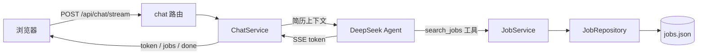
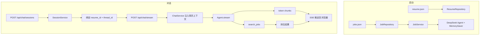

<div align="center">

# 求职 AI

**基于 FastAPI / DeepSeek / LangChain 构建的 AI 求职助手 Demo。用户选择预置简历后，用自然语言描述求职需求；系统结合简历背景调用 DeepSeek Agent，必要时追问关键信息，从演示岗位数据中推荐合适岗位，回复以 SSE 流式逐 token 显示。**

[](https://www.python.org/) [](https://fastapi.tiangolo.com/) [](https://python.langchain.com/) [](https://langchain-ai.github.io/langgraph/) [](https://platform.deepseek.com/)

</div>

---

## 📖 项目简介

本项目是一个用于求职作品集展示的 AI 求职助手 Agent。用户从 3 份预置示例简历中选择一个求职者，用自然语言描述求职需求，系统结合简历背景和演示招聘岗位，通过 DeepSeek Agent 理解需求，必要时主动追问关键信息，从本地演示岗位数据中推荐约 3 个合适岗位并说明推荐理由，也可根据用户后续反馈调整推荐。

所有岗位和简历均为**虚构演示数据**，不代表真实招聘信息。

## 🧱 项目结构

```text
job-ai/
├── main.py                         # FastAPI 入口：lifespan、CORS、路由注册
├── utils/
│   └── path_tool.py                # 项目根路径定位，与工作目录无关
├── app/
│   ├── api/
│   │   ├── dependencies.py         # FastAPI 依赖注入
│   │   └── routes/                 # health / resumes / jobs / chat 路由
│   ├── agents/
│   │   ├── model/deepseek.py       # DeepSeek 模型客户端
│   │   ├── prompts/
│   │   │   ├── job_prompts.py      # 系统提示词（含简历上下文注入接口）
│   │   │   └── resume_context.py   # Resume 模型 → Prompt 文本
│   │   ├── tools/search_jobs.py    # search_jobs 工具（调用 JobService）
│   │   └── factory/deepseek_agent.py  # create_agent 组装
│   ├── schemas/                    # Pydantic 数据模型
│   ├── repositories/               # 数据访问层（JSON 加载，启动时建 ID 索引）
│   ├── services/
│   │   ├── job_service.py          # 岗位筛选业务逻辑
│   │   ├── session_service.py      # 会话管理（内存，绑定简历 + thread_id）
│   │   └── chat_service.py         # 聊天编排（简历注入 + Agent 调用 + SSE 流）
│   ├── data/
│   │   ├── resume.json             # 3 份预置简历
│   │   └── jobs.json               # 120 条演示岗位
│   └── static/                     # 前端（Vue 3 CDN）
├── tests/                          # 手动检查脚本 + pytest 用例
├── .env.example
└── requirements.txt
```

## ✨ 主要特性

| 特性 | 说明 |
| --- | --- |
| 简历上下文注入 | 将选中简历格式化后注入系统提示词，Agent 结合求职者背景给出个性化推荐 |
| DeepSeek Agent | 基于 LangGraph `create_agent`，使用 `MemorySaver` 保存多轮会话历史，支持工具调用 |
| 岗位工具调用 | Agent 主动调用 `search_jobs` 工具查询真实演示数据，不编造岗位 |
| SSE 流式回复 | 逐 token 推送，工具调用结果单独推送，前端实时渲染 |
| 会话隔离 | 每个会话生成独立 `session_id` 和 `thread_id`，不同用户上下文互不干扰 |
| Vue 3 前端 | 无需构建工具，CDN 引入 Vue 3，简历选择 / 聊天 / 岗位卡片 / 响应式布局 |

## 🏗️ 系统架构



## 🔄 数据流



## 🧰 技术栈

- **Python 3.10**
- **FastAPI + Uvicorn** — HTTP 接口与 SSE 流式
- **LangChain + LangGraph** — Agent 编排、工具调用、多轮会话检查点
- **langchain-deepseek** — DeepSeek 模型接入
- **Pydantic v2** — 请求/响应校验与数据模型
- **Vue 3（CDN）** — 前端，无独立构建工程

## 📦 演示数据

### 预置简历（3 份）

| ID | 求职者 | 背景 | 技能 |
| --- | --- | --- | --- |
| `resume_sales_001` | 林晓 | 3 年销售经验，希望转行 | 客户沟通、客户维护、跨部门协调 |
| `resume_graduate_001` | 陈悦 | 应届生，市场营销专业 | 办公软件、文案整理、活动组织 |
| `resume_developer_001` | 周凯 | 2 年 Python 后端经验 | Python、FastAPI、SQL、大模型应用开发 |

### 演示岗位（120 条）

- **城市**：北海市海城区、银海区、铁山港区、合浦县
- **类别**：销售、客服、行政文员、服务业、运营、技术开发、设计、财务会计、物流仓储、教育培训、物业安保、市场新媒体（每类 10 条）
- **薪资范围**：2,600 ~ 14,000 元 / 月

> 所有数据均为虚构，仅用于功能演示。

## 🚀 快速开始

### 1️⃣ 安装依赖

```bash
pip install -r requirements.txt
```

### 2️⃣ 配置 API Key

```bash
cp .env.example .env
# 在 .env 中填入 DEEPSEEK_API_KEY
```

在 [DeepSeek 开放平台](https://platform.deepseek.com/) 申请 API Key 后填入。

### 3️⃣ 启动服务

```bash
python -m uvicorn main:app --reload
```

访问 **`http://127.0.0.1:8000`** 打开聊天页面，或访问 `http://127.0.0.1:8000/docs` 查看 API 文档。

## 🖥️ 使用方式

1. 左栏选择一份**预置简历**，系统自动创建会话并绑定简历背景
2. 在输入框描述求职需求，例如：`我想在北海找一份运营工作，期望月薪 5000 元以上`
3. AI 顾问会结合简历背景理解需求，信息不足时主动追问
4. 推荐岗位以列表形式出现在 AI 回复下方，点击**查看详情**展开完整岗位信息
5. 继续补充或修改偏好，AI 根据新要求调整推荐
6. 点击**查看全部演示岗位数据**可浏览所有 120 条演示岗位

## ⚙️ 环境变量

| 变量 | 说明 | 默认值 |
| --- | --- | --- |
| `DEEPSEEK_API_KEY` | DeepSeek API 密钥 | 无（必填） |

## 🔌 接口

| 方法 | 路径 | 说明 |
| --- | --- | --- |
| GET | `/` | 前端聊天页面 |
| GET | `/api/health` | 健康检查 |
| GET | `/api/resumes/` | 获取所有预置简历 |
| GET | `/api/resumes/{id}` | 获取指定简历详情 |
| GET | `/api/jobs/` | 搜索演示岗位（支持 keyword / city / category / 薪资筛选） |
| GET | `/api/jobs/{id}` | 获取指定岗位详情 |
| POST | `/api/chat/sessions` | 创建会话，绑定简历 |
| POST | `/api/chat` | 发送消息（非流式，保留供 Swagger 测试） |
| POST | `/api/chat/stream` | 发送消息（SSE 流式） |

`POST /api/chat/stream` 的 SSE 事件：

| 事件类型 | 说明 |
| --- | --- |
| `token` | AI 回复文字片段，逐 token 推送 |
| `jobs` | 工具查询到的岗位列表，回复结束前推送 |
| `done` | 流正常结束 |
| `error` | 出错信息 |

## ⚠️ 已知限制

- **会话仅存内存**：服务重启后所有会话和对话历史丢失，不适合生产环境。
- **演示数据**：所有简历和岗位均为虚构数据，不代表真实招聘信息，不支持投递。
- **单一模型**：目前仅支持 DeepSeek，模型名和 temperature 硬编码在代码中。
- **无认证限流**：公开部署前需增加访问控制，每次对话消耗 API 额度。

## 🗺️ 后续计划

### Agent 能力增强

- **更智能的追问策略** — 目前 Agent 依赖 Prompt 判断何时追问，后续计划将追问逻辑结构化，根据用户已提供的信息缺口精准提问，避免重复询问已知条件或一次抛出过多问题
- **记忆持久化** — 当前会话历史仅保存在内存中，服务重启即丢失。计划接入持久化存储（如 SQLite 或 Redis），让用户跨会话继续之前的求职对话
- **多模型支持** — 目前仅支持 DeepSeek，计划支持通过配置切换不同模型（如 OpenAI、Qwen、本地 Ollama），方便在不同场景下选择最合适的模型

